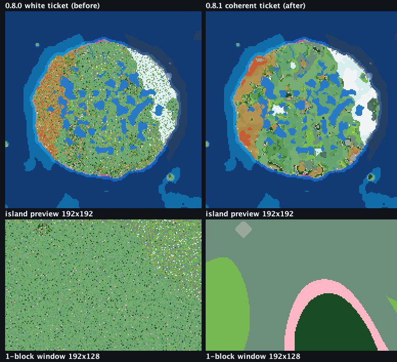
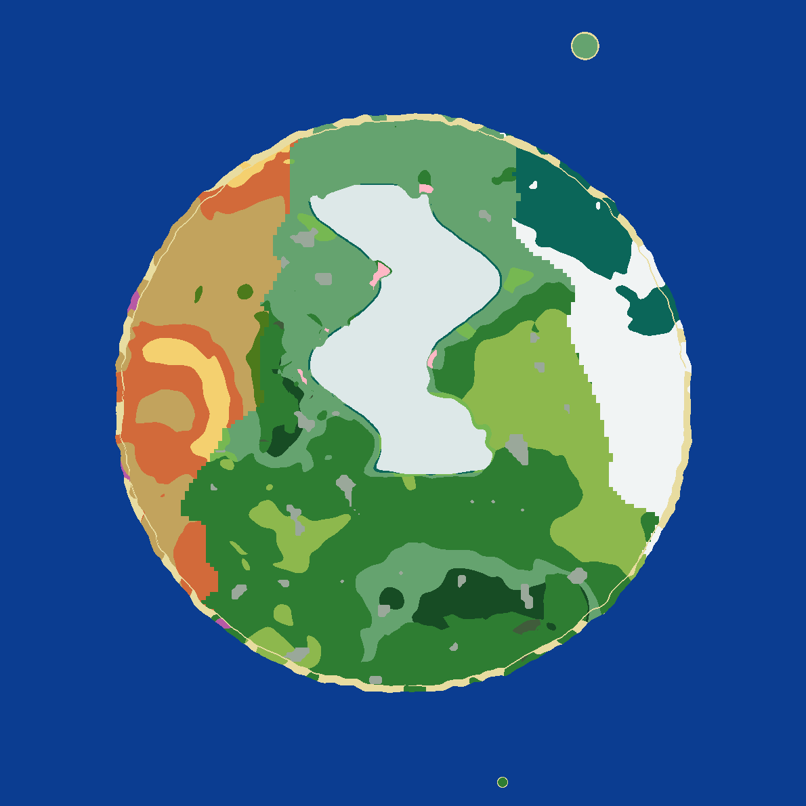
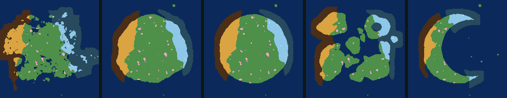

# OmniIsle — All Biomes & Structures on One Island

**OmniIsle** is an open-source Minecraft mod for Fabric (Minecraft 26.3, Java 25) that transforms standard infinite Overworld generation into a standalone, fully customizable, isolated island surrounded by an endless ocean.

Every Overworld biome (all 56 vanilla biomes, including Pale Garden, Dappled Forest, and Sulfur Caves) and 18 structure options can generate on a single island, balanced and ready for exploration, survival, and server events.

---

## Features

### In-Game Island Editor
* Embedded directly into the "Create New World" screen (World Type: **OmniIsle**).
* **Flat dark UI (1.0.0):** the editor is built from our own widgets — top bar, icon tool column, six editor tabs, scrollable controls, a biome list with live preview shares and a status bar — with density tiers that stay usable from 1920×1080 down to 320×150 logical pixels (below that it shows an honest notice instead of clipped controls). Tooltips (400 ms), toasts, confirmation popovers, keyboard navigation and screen-reader narration are included; en_us and ru_ru are both fitted and tested.
* **Interactive Canvas:** Draw land and height layers in real-time with brush sizes from 1 to 24 pixels.
* **Canvas Resolutions:** Choose between 192×192 (default), 256×256, or 384×384 with bilinear resampling.
* **Preview Modes:** Switch the canvas between terrain colors, the height layer, the biome map and the shore map without regenerating anything.
* **Drawing Tools:** Freehand brush, Flood Fill, Line, Rectangle, and Ellipse (hold Shift for square/circle; fill/outline toggle), plus Smooth.
* **Symmetry Modes:** Off, Mirror-X, Mirror-Z, 4-Way, 6-Way, and 8-Way radial symmetry.
* **Zoom & Pan:** Smooth 1×–8× canvas zoom with scroll wheel; middle-click or Space-drag to pan; 16px grid overlay toggle.
* **13 Presets:** Natural, Round, Long, Crescent, Archipelago, Atoll, Volcano, Fjords, Twin Islands, Inland Sea, Horseshoe Bay, and Ridge Island, plus the fixed **Mineshield 4 Map** traced from the bundled reference map (land mask + relief only; biomes still follow the climate system).
* **PNG Import/Export:** Import custom heightmaps or masks with threshold, invert, aspect-preserving letterbox, and height quantiles. Export B/W mask, height layer, color biome map, relief hillshade, and shore map.
* **Share Codes:** One-click copy/paste of island designs via compact compressed share codes (`OMNI2-...`).

### Three Generation Versions
* **v3 (default for new worlds, revised in place):** v2 terrain plus deterministic shore fields, a smooth deep-ocean ramp, a guaranteed monument band, islets outside that band, river mouths crossing the waterline, relaxed pyramids, fixed three-start strongholds, since 0.8.4 universal climate provinces (a temperate heartland with one warm/arid and one cold/snowy sector on every shape preset), since Phase 13 a real dry-spawn search plus lifted highlands (the editor preview's ~260-block peaks are actually generated; the circular spawn dome is gone), and since 1.0.1 open-coast-only beaches, five biome-matched village variants at −60 % density, and continuous warm↔cold climate bands with province-independent mountain snow. Existing v3 worlds keep their generated datapack — create a new world.
* **v2:** exact 0.6.0 output (bit-for-bit frozen by `GoldenV2Test`): EDT + Catmull-Rom SDF, domain warping, ridged mountains, 4-tier heightmaps, bathymetry, islets, rivers.
* **v1:** exact 0.5.0 output (`GoldenV1Test`) for existing worlds.

### Terrain & Ocean
* **High-Precision SDF:** Exact Felzenszwalb-Huttenlocher Euclidean Distance Transform on native grids with sub-pixel distance convention and clamped Catmull-Rom bicubic resampling.
* **Organic Coastlines (v2/v3):** Domain warping applied only to mask lookup, plus shoreline micro-roughness centered on the real shoreline value (-0.08).
* **Patchy Shores (v3, open-coast gated in 1.0.1):** `ShoreField` produces sand, snowy beach, or stony shore pockets with bays, notches, and slope-aware cliffs; configurable density, variety, and rockiness. Every beach now also requires a genuinely open water body (ring minimum distance ≤ −55), a low coastal shelf (height tier ≤ 1.10, continentalness ≤ 0.20) and a bay, so narrow fjord banks and interior inlets no longer grow sand ribbons.
* **Inland Relief:** Compressed coastal rise, procedural ridged mountain spines, and painted 4-tier heightmaps (Lowland, Normal, Plateau, Alpine Peaks) with smooth transitions.
* **Bathymetry:** Soft ocean floor at -0.80, seabed fBm/trenches down to -1.0, and a continuous deep band for Ocean Monuments.
* **Satellite Islets:** Outer-archipelago islets generated beyond the monument band with configurable density.
* **Physically Carved Rivers & Lakes:** Deterministic Priority-Flood + D8 network; v3 carves river mouths through the waterline.

### Climate & Biome System
* **Biome Scale Slider:** Configurable `climate_scale` (384 to 1536 blocks).
* **Latitudinal Temperature Gradients:** North-South, East-West, or Radial gradients with theme-aware amplitude compression.
* **Noise-Jittered Blending:** Organic transitions between climate families with no straight-line borders.
* **Dynamic Biome Discovery:** Automatically detects and integrates datapack and modded biomes from `WorldCreationContext`.
* **Universal Climate Provinces (0.8.4, transitions 1.0.1):** every shape preset gets one cohesive warm/arid sector (west/SW), one cold/snowy sector (north-east arc), and a 60–75 % temperate heartland from the shared `ClimateLayout` quantile masks. Province contours are sampled bilinearly from the smoothed strength fields against quantile-calibrated thresholds with a 160-block boundary noise, so sector edges are continuous curves rather than grid stairs. Since 1.0.1 land families are selected by the continuous warm-vs-cold strength distance instead of the categorical province, with core and band thresholds: a meadow/birch/plains/savanna band always separates warm and cold cores, so taiga never touches desert. Snow peaks (family 15) require `c > 0.50` and `heightTier >= 1.5` in **any** province — a snow-capped mountain next to a desert is intentional; lowlands keep their band. Province strength still tints adjacent ocean sectors (`warm_ocean`, `lukewarm_ocean`, `cold_ocean`, `frozen_ocean`) with transition bands at the rim. Wetlands are low, flat coast only (`c < 0.15`, slope < 0.12, tier ≤ 1.0); pale gardens and ice spikes are small pockets (measured 0.9–1.6 % of land for pale); cherry groves live on mid foothills; mushrooms only on separate islets (`main < 0`, 0 % on the main island). The dry coastal shelf is land (or stony shore), never ocean.
* **Reference Continent Climate (0.8.2, v3):** a temperature/humidity field backed by elevation cooling and the physical mountain ridge produces a central snowy spine, ~68 % core temperate land, a cohesive low/mid warm-arid region, coastal swamps/mangroves, and offshore-only mushroom islands.
* **Per-Biome Frequency:** Every climate-driven land biome has a 0–400 % relative-frequency field (default 100); 0 disables it and other biomes absorb the difference. A deterministic calibration writes per-biome biases into the optional `biome_share` config; all-100 remains bit-identical to 0.7.0. The weighted picker uses a coherent 420-block fBm ticket (0.8.1), so weighted islands form continuous patches instead of 1-block noise.

### Structures & Safe Spawn
* **Small-Island Scaling:** Stronghold rings scale with island size; v3 places exactly three starts inside the island.
* **Deep Dark Ancient Cities:** Subterranean placement decoupled from surface peaks.
* **Strict Fixed Structures (0.8.2, extended 0.8.4):** pyramids, jungle temples, swamp huts, mansions, igloos, outposts, trail ruins, portals, camps, mineshafts, monuments, ruins, shipwrecks and buried treasure are placed only in their valid family, province sector, continentalness, slope and elevation sites (0.8.4 adds the `WARM`/`COLD` province check and a maximum surface Y per structure). If no valid site exists the set is exported disabled — there is no high-continentalness or any-category fallback. `RelaxedPyramids` re-validates the site at runtime.
* **Biome-Matched Villages (1.0.1):** v3 places all five vanilla village types — plains (birch/forest/plains/meadow/cherry), desert/badlands, savanna, snowy (without ice spikes) and taiga — each tagged only to its matching families, at about **40 %** of the previous density (spacing 54 instead of 34, i.e. −60.4 %). Island-size and the structure-density setting still scale the result; v1/v2 keep the frozen single-plains placement.
* **Inland Spawn Selector:** Chooses the inland pixel with the highest positive distance to coast; v3 verifies the real column at server start and, if it is wet, moves the spawn to the first dry column within 512 blocks (no terrain dome).
* **World Border:** Optional island-bounded world border with configurable margin (500 to 4000 blocks).

---

## Screenshots & Evidence

Before/after the v3 shore redesign (same editor draft, `ROUND`, 4000 blocks, seed 4242):

| Before (v2 ribbon) | After (v3 shore field) |
| :---: | :---: |
|  |  |

Weighted biomes before/after the 0.8.1 coherent-ticket fix (NATURAL, 4000, Cherry Grove 45 %;
the 0.8.0 side is per-block noise, the 0.8.1 side forms continuous patches):



```text
cherry weight 45 -> target 17.32 % of land, held-out 17.82 % (0.50 pp error)
1-block window: agreement 0.218 -> 0.994, isolated pixels 43.9 % -> 0.0 %
```

Reference continent climate after the 0.8.2 v3 fix (NATURAL/ALL, 3500, seed 2025;
4-block overview on the left, 1-block coast close-up on the right):

| Reference overview | Coast close-up |
| :---: | :---: |
|  |  |

The **Mineshield 4 Map** preset is a fixed extraction of the bundled reference map:
30.47 % land, no border land, 91.06 % largest component, cleaned relief tiers
612 / 1,431 / 9,189 pixels for plateau / mesa / lowland (`docs/evidence/presets/mineshield_4_mask.png`).
The 0.8.4 cleanup keeps one curved tier-3 range in the central north and a western tier-2
mesa band, with isolated specks removed. It ignores the shape seed; biomes are still generated
by the selected theme and climate.

Universal 0.8.4 climate provinces on all five shipping presets (land province map, warm = amber,
cold = blue, pale pockets = pink; 320 px panels per preset):



Measured composition with v3 defaults (1.0.1 climate bands), 256×256 sample grid, seed 2025 — every
preset meets warm ≥8 %, cold ≥8 %, green 60–75 %, rare families <3.5 %, and the zero-counter gates
(wetlands above `c=0.18`, snow below tier 1.4 outside cold, mushrooms on the main island,
ocean on the dry shelf). Full numbers: [`composition_controlled.csv`](docs/evidence/phase11/after/composition_controlled.csv),
[`summary_after.txt`](docs/evidence/phase11/after/summary_after.txt).

| Preset | Warm 11/12/13 | Cold 0/1 | Green 2–7+17 | Cherry 6 | Mushroom 16 | Pale 17 |
| :--- | ---: | ---: | ---: | ---: | ---: | ---: |
| Mineshield 4 Map | 16.11 % | 15.46 % | 66.59 % | 1.12 % | 1.02 % | 1.39 % |
| Natural | 17.52 % | 14.39 % | 67.37 % | 2.67 % | 0.15 % | 0.93 % |
| Round | 17.47 % | 14.21 % | 67.61 % | 2.66 % | 0.12 % | 0.94 % |
| Archipelago | 14.51 % | 13.96 % | 68.90 % | 1.39 % | 0.87 % | 1.42 % |
| Crescent | 17.32 % | 13.86 % | 68.57 % | 2.14 % | 0.25 % | 1.21 % |

Province membership follows the smoothed strength rasters sampled bilinearly against
quantile-calibrated thresholds, with a 160-block boundary-noise contour and a coastal
inheritance margin; ocean subtypes blend through `lukewarm`/`cold` transition bands. Province and
ocean contours are therefore continuous organic curves instead of 18–20-block stairs, while the
quantiles keep the measured sector shares unchanged. Natural ocean edge:
[`ocean_edge_natural.png`](docs/evidence/phase11/after/ocean_edge_natural.png).

Coastal sand arcs: median run 36–70 blocks (target 25–90); 10 of 144 components are ≤3 blocks
across the five presets, and the Phase 14 sampled coastal columns contain 0 interior/shallow/
high-tier violations. The zero-speck target is **PARTIAL** — the achieved distribution is
recorded in [`shore_runs.csv`](docs/evidence/phase11/after/shore_runs.csv) instead of claiming
perfection.

More previews and measured datasets live in [`docs/evidence/`](docs/evidence/): coast overlays,
climate family maps, relief maps, river-mouth probes, ocean depth maps, structure/spawn tables.
Real-client UI captures (200 PNGs, four window sizes, GUI scales 1–4, en_us/ru_ru), the manifest,
the render-cost table and the known coverage limits are in
[`UI_CHECKLIST.md`](UI_CHECKLIST.md) and [`docs/screens/1.0.0/`](docs/screens/1.0.0/). MEDIUM is
covered by unit tests only and MINIMAL is unreachable in a real client because Minecraft clamps the
logical area to at least 320×240.

---

## World Compatibility

> [!IMPORTANT]
> **Old Worlds Keep Generating Identically (Invariant I1):**
> Worlds created with OmniIsle 0.5.0 (`generation_version = 1`) and 0.6.0 (`generation_version = 2`) load in 1.0.1 and generate later chunks **bit-for-bit identically** — no seams, no biome drift. `GoldenV1Test` and `GoldenV2Test` compare sampled doubles/bit patterns exactly. New worlds default to **v3**; existing worlds keep their stored version.
>
> v3 worlds are intentionally different after 0.8.2, and **0.8.4 changed v3 climate/biomes again**: universal province sectors sampled as continuous contours, the elevation-gated snow/wetland rules, rare-biome pockets, province ocean sectors with transition bands, cleaned Mineshield tiers, stricter structures and longer shore arcs. **Phase 13 changed v3 terrain resources once more**: the circular spawn dome is gone, the spawn is a validated dry column (may differ from the editor marker), and generated highlands reach the advertised heights through an offset lift with a 300→316 fade. **1.0.1 (Phase 14) changed v3 again**: beaches are gated to open coasts and low shelves, v3 villages are five biome-matched variants at −60 % density, and warm↔cold province walls were replaced with continuous climate bands (mountain snow is now allowed in any province). Existing v3 chunks keep their generated biomes and terrain; **worlds created before Phase 14 keep their old generated datapack and are not repaired — create a new world to get the fixes**. No `generation_version` was added. Weighted worlds created with 0.8.0 also remain different: their old per-block noise ticket was replaced in 0.8.1.

> [!NOTE]
> **0.8.1+ world-preset safety:** the editor validates the generated datapack preset through the live worldgen registry before enabling it. If validation fails, the editor shows a localized error instead of letting world creation crash.
>
> **0.8.3 Mineshield 4 Map** only adds an editor shape preset. It does not change `generation_version` or worldgen, so existing drafts, share codes and worlds are unaffected.

---

## Performance

Real dedicated-server chunk generation (fresh world per run, 25×25 inland chunks, 3 interleaved
reps, seed 4242, ROUND 4000) is recorded in
[`docs/evidence/perf/chunkgen_25x25.csv`](docs/evidence/perf/chunkgen_25x25.csv).
Median 625-chunk generation: **v1 14.891 s, v2 14.231 s (−4.4 %), v3 14.557 s (−2.2 %)**;
the worst modern run is +6.7 % over the fastest v1 run, inside the +15 % budget. Method,
pre/post-cache probes and offshore diagnostics are in
[`docs/evidence/perf/README.md`](docs/evidence/perf/README.md).

---

## Dedicated Server Support

OmniIsle works out of the box on dedicated servers:

### 1. Auto-Generation via `config/omniisle.json`
Place an exported OmniIsle preset JSON file in `config/omniisle.json`. When the server boots for the first time without a world, OmniIsle automatically builds and registers `world/datapacks/omniisle-generated.zip`.

### 2. In-Game & Console Commands
* `/omniisle info` — Displays generation version, resolution, island size, bounding box, spawn, and active layers.
* `/omniisle verify` — Probes surface elevation and biome distribution across coordinates.
* `/omniisle debug <continentalness|height|biome|river|tier> [radius] [step]` — Exports real server-side PNG map images to `omniisle/debug/`.
* `/omniisle import <preset-name|OMNI2-...>` — Imports a named preset from `omniisle/presets/` or a share code directly into the server's world datapacks folder.

---

## Building from Source

Requirements: JDK 25 and Gradle.

```bash
git clone https://github.com/y9hack337/OmniIsle.git
cd OmniIsle
./gradlew build
```

The resulting mod JAR will be located in `build/libs/OmniIsle-26.3-Fabric-1.0.1+mc26.3.jar`.

---

## License

OmniIsle is licensed under the GPL-3.0 License.
