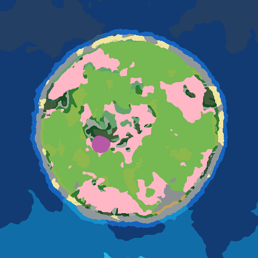
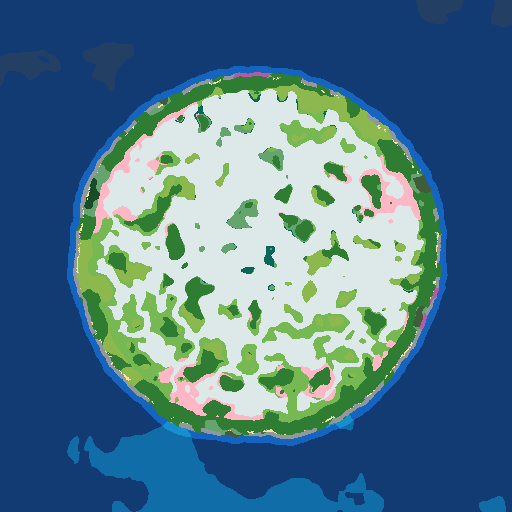

# OmniIsle — All Biomes & Structures on One Island

**OmniIsle** is an open-source Minecraft mod for Fabric (Minecraft 26.3, Java 25) that transforms standard infinite Overworld generation into a standalone, fully customizable, isolated island surrounded by an endless ocean.

Every Overworld biome (all 56 vanilla biomes, including Pale Garden, Dappled Forest, and Sulfur Caves) and 18 structure options can generate on a single island, balanced and ready for exploration, survival, and server events.

---

## Features

### In-Game Island Editor
* Embedded directly into the "Create New World" screen (World Type: **OmniIsle**).
* **Interactive Canvas:** Draw land and height layers in real-time with brush sizes from 1 to 24 pixels.
* **Canvas Resolutions:** Choose between 192×192 (default), 256×256, or 384×384 with bilinear resampling.
* **Drawing Tools:** Freehand brush, Flood Fill, Line, Rectangle, and Ellipse (hold Shift for square/circle; fill/outline toggle), plus Smooth.
* **Symmetry Modes:** Off, Mirror-X, Mirror-Z, 4-Way, 6-Way, and 8-Way radial symmetry.
* **Zoom & Pan:** Smooth 1×–8× canvas zoom with scroll wheel; middle-click or Space-drag to pan; 16px grid overlay toggle.
* **12 Procedural Presets:** Natural, Round, Long, Crescent, Archipelago, Atoll, Volcano, Fjords, Twin Islands, Inland Sea, Horseshoe Bay, and Ridge Island.
* **PNG Import/Export:** Import custom heightmaps or masks with threshold, invert, aspect-preserving letterbox, and height quantiles. Export B/W mask, height layer, color biome map, relief hillshade, and shore map.
* **Share Codes:** One-click copy/paste of island designs via compact compressed share codes (`OMNI2-...`).

### Three Frozen Generation Versions
* **v3 (default for new worlds):** v2 terrain plus deterministic shore fields, a smooth deep-ocean ramp, a guaranteed monument band, islets outside that band, river mouths crossing the waterline, a dry spawn plateau, relaxed pyramids, and fixed three-start strongholds.
* **v2:** exact 0.6.0 output (bit-for-bit frozen by `GoldenV2Test`): EDT + Catmull-Rom SDF, domain warping, ridged mountains, 4-tier heightmaps, bathymetry, islets, rivers.
* **v1:** exact 0.5.0 output (`GoldenV1Test`) for existing worlds.

### Terrain & Ocean
* **High-Precision SDF:** Exact Felzenszwalb-Huttenlocher Euclidean Distance Transform on native grids with sub-pixel distance convention and clamped Catmull-Rom bicubic resampling.
* **Organic Coastlines (v2/v3):** Domain warping applied only to mask lookup, plus shoreline micro-roughness centered on the real shoreline value (-0.08).
* **Patchy Shores (v3):** `ShoreField` produces sand, snowy beach, or stony shore pockets with bays, notches, and slope-aware cliffs; configurable density, variety, and rockiness.
* **Inland Relief:** Compressed coastal rise, procedural ridged mountain spines, and painted 4-tier heightmaps (Lowland, Normal, Plateau, Alpine Peaks) with smooth transitions.
* **Bathymetry:** Soft ocean floor at -0.80, seabed fBm/trenches down to -1.0, and a continuous deep band for Ocean Monuments.
* **Satellite Islets:** Outer-archipelago islets generated beyond the monument band with configurable density.
* **Physically Carved Rivers & Lakes:** Deterministic Priority-Flood + D8 network; v3 carves river mouths through the waterline.

### Climate & Biome System
* **Biome Scale Slider:** Configurable `climate_scale` (384 to 1536 blocks).
* **Latitudinal Temperature Gradients:** North-South, East-West, or Radial gradients with theme-aware amplitude compression.
* **Noise-Jittered Blending:** Organic transitions between climate families with no straight-line borders.
* **Dynamic Biome Discovery:** Automatically detects and integrates datapack and modded biomes from `WorldCreationContext`.
* **Per-Biome Frequency:** Every climate-driven land biome has a 0–400 % relative-frequency field (default 100); 0 disables it and other biomes absorb the difference. A deterministic calibration writes per-biome biases into the optional `biome_share` config; all-100 remains bit-identical to 0.7.0.

### Structures & Safe Spawn
* **Small-Island Scaling:** Stronghold rings scale with island size; v3 places exactly three starts inside the island.
* **Deep Dark Ancient Cities:** Subterranean placement decoupled from surface peaks.
* **Inland Spawn Selector:** Chooses the inland pixel with the highest positive distance to coast; v3 adds a dry plateau under the marker and reconciles the world spawn after server start.
* **World Border:** Optional island-bounded world border with configurable margin (500 to 4000 blocks).

---

## Screenshots & Evidence

Before/after the v3 shore redesign (same editor draft, `ROUND`, 4000 blocks, seed 4242):

| Before (v2 ribbon) | After (v3 shore field) |
| :---: | :---: |
|  |  |

More previews and measured datasets live in [`docs/evidence/`](docs/evidence/): coast overlays,
climate family maps, relief maps, river-mouth probes, ocean depth maps, structure/spawn tables.
UI screenshots at GUI scales 1–4 are still outstanding; see [`UI_CHECKLIST.md`](UI_CHECKLIST.md).

---

## World Compatibility

> [!IMPORTANT]
> **Old Worlds Keep Generating Identically (Invariant I1):**
> Worlds created with OmniIsle 0.5.0 (`generation_version = 1`) and 0.6.0 (`generation_version = 2`) load in 0.8.0 and generate later chunks **bit-for-bit identically** — no seams, no biome drift. `GoldenV1Test` and `GoldenV2Test` compare sampled doubles/bit patterns exactly. New worlds default to **v3**; existing worlds keep their stored version.

---

## Performance

Real dedicated-server chunk generation (fresh world per run, 25×25 inland chunks, 3 interleaved
reps, seed 4242, ROUND 4000) is recorded in
[`docs/evidence/perf/chunkgen_25x25.csv`](docs/evidence/perf/chunkgen_25x25.csv).
Median 625-chunk generation: **v1 14.891 s, v2 14.231 s (−4.4 %), v3 14.557 s (−2.2 %)**;
the worst modern run is +6.7 % over the fastest v1 run, inside the +15 % budget. Method,
pre/post-cache probes and offshore diagnostics are in
[`docs/evidence/perf/README.md`](docs/evidence/perf/README.md).

---

## Dedicated Server Support

OmniIsle works out of the box on dedicated servers:

### 1. Auto-Generation via `config/omniisle.json`
Place an exported OmniIsle preset JSON file in `config/omniisle.json`. When the server boots for the first time without a world, OmniIsle automatically builds and registers `world/datapacks/omniisle-generated.zip`.

### 2. In-Game & Console Commands
* `/omniisle info` — Displays generation version, resolution, island size, bounding box, spawn, and active layers.
* `/omniisle verify` — Probes surface elevation and biome distribution across coordinates.
* `/omniisle debug <continentalness|height|biome|river|tier> [radius] [step]` — Exports real server-side PNG map images to `omniisle/debug/`.
* `/omniisle import <preset-name|OMNI2-...>` — Imports a named preset from `omniisle/presets/` or a share code directly into the server's world datapacks folder.

---

## Building from Source

Requirements: JDK 25 and Gradle.

```bash
git clone https://github.com/y9hack337/OmniIsle.git
cd OmniIsle
./gradlew build
```

The resulting mod JAR will be located in `build/libs/OmniIsle-26.3-Fabric-0.8.0+mc26.3.jar`.

---

## License

OmniIsle is licensed under the GPL-3.0 License.
